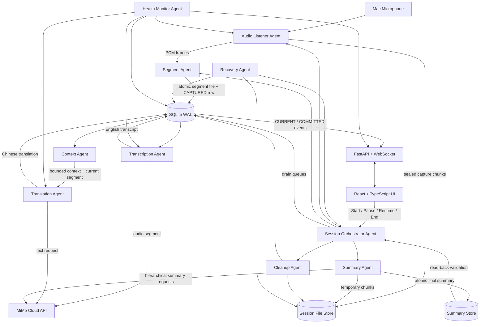
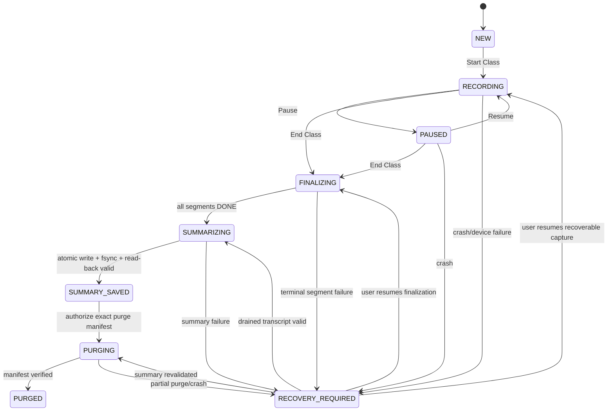
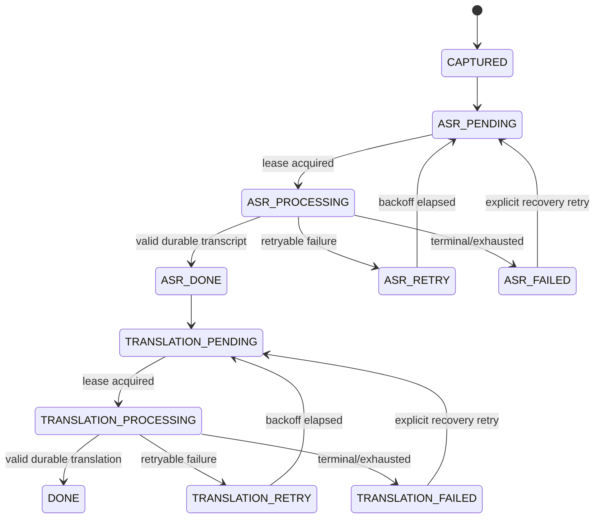

# Classroom Interpreter — Architecture

Status: `PHASE_0_APPROVED_WITH_AMENDMENTS — PHASE_1_REVIEW_CANDIDATE`  
Version: `0.2`  
Last updated: `2026-09-06`

## 1. Purpose and freeze boundary

Classroom Interpreter is a macOS local-first application that captures an English lecture, produces near-real-time English transcription and Simplified Chinese translation, creates a structured post-class summary, and purges all raw classroom data only after that summary has been safely saved and verified.

This document defines the Phase 0 architecture. It is a freeze candidate, not an implementation claim. Phase 1 may create only the approved skeleton and contracts. Any material change to data flow, state machines, persistence, privacy, provider protocols, or purge rules must be recorded in `DECISIONS.md` before implementation.

The V1 optimization order is:

1. no loss of already captured audio;
2. correct recovery and purge safety;
3. three-hour stability;
4. correct, ordered subtitles;
5. latency;
6. visual polish.

## 2. Architectural shape

V1 is a **local modular monolith with independently testable runtime agents**, not ten network services. Agent means a work unit with its own contract, state, error policy, heartbeat, and forbidden responsibilities. The agents may run as isolated asyncio tasks, worker threads, or a dedicated helper process where blocking I/O requires it. They communicate through typed contracts and the persistent SQLite queue, never by importing another agent's internal implementation.

The microphone is owned by the backend capture layer, not by the browser. A browser refresh therefore cannot stop an active recording. The React UI is a local control and display surface only. Phase 2 starts with an explicit capture spike: test a simple Python/CoreAudio-compatible adapter first; retain it only if permission handling, device reconnect, and three-hour stability pass. Otherwise escalate to a small Swift/AVFoundation helper over IPC. The decision must be frozen before production audio-pipeline implementation and recorded as an ADR.

Runtime content is stored outside the Git checkout under an OS application-data directory, expected to be:

`~/Library/Application Support/Classroom Interpreter/`

The path is configurable for tests. The server binds to `127.0.0.1` only.

### Technology boundary

- Frontend: React, TypeScript, Vite; a display/control client with no microphone ownership.
- Backend: Python, FastAPI, asyncio-compatible workers, and a dedicated capture execution context.
- Realtime: WebSocket events with sequence cursors; REST for idempotent commands and recovery.
- Persistence: SQLite in WAL mode plus atomic session-scoped files.
- Audio: macOS CoreAudio through an adapter selected by a measured spike; local deterministic VAD.
- Providers: MiMo HTTP/OpenAI-compatible protocol behind typed adapters; deterministic mocks for tests.
- Tests: pytest for backend/contracts and focused frontend/E2E tests for state, ordering, and reconnect.

Library and runtime versions are selected and pinned in Phase 1 after compatibility checks. Phase 0 does not create dependencies.

## 3. System diagram



Cloud-bound arrows are limited to ASR audio segments, bounded translation text/context, and summary material. The product must never be described as `100% local`.

## 4. Critical data flow

### 4.1 Capture and segmentation

1. Audio Listener opens the selected input device and emits timestamped 16 kHz mono PCM frames when the device supports that path. Any device-side resampling is explicit and measured.
2. The listener continuously seals short **recovery capture chunks** to disk. These chunks are durability units, not ASR segments. They prevent a crash during a long utterance from losing all unclosed audio.
3. Segment Agent runs local deterministic VAD and silence detection across frames/chunk boundaries. It creates semantic ASR segments using configurable minimum, preferred, maximum, silence, and overlap values.
4. A segment file is written to a temporary name, flushed, atomically renamed, and only then inserted into SQLite as `CAPTURED`.
5. Recovery scans both SQLite and the session directory, reconciling orphan files and incomplete temporary files. No API call starts until a durable segment record exists.

This preserves `PERSIST FIRST, PROCESS SECOND` without confusing fixed durability chunks with natural-language ASR segmentation.

### 4.2 Realtime processing

1. The scheduler moves `CAPTURED` to `ASR_PENDING`.
2. Transcription Agent claims work with a lease, moves it to `ASR_PROCESSING`, calls the configured ASR provider, validates non-empty English text, and commits `ASR_DONE`.
3. ASR may complete out of order. Translation workers may serve multiple sessions, but each session has its own ordered-commit cursor. Context Agent reads only committed previous segments within the configured count/time/token window.
4. Translation Agent leases the next eligible sequence for that session, sends bounded context plus the current segment, validates output, and advances that session's cursor. A timeout enters bounded retry/recovery; it never holds a process-wide lock or waits forever.
5. The WebSocket publisher emits monotonically sequenced events. English text may appear as `CURRENT` after `ASR_DONE`; a subtitle becomes `COMMITTED` only after both ASR and translation are durable.
6. Previously committed subtitles are immutable in V1. Corrections, if ever added, require a separate versioned product decision.

### 4.3 End Class and finalization

`End Class` is a drain operation, not a delete operation:

```text
stop accepting new frames
→ seal capture tail
→ finish remaining segmentation
→ drain ASR and translation queues in sequence order
→ verify every segment is DONE
→ build ordered temporary transcript
→ hierarchical summary
→ validate summary structure and content
→ atomic write outside the temporary session directory
→ fsync and read-back validation
→ set SUMMARY_SAVED
→ purge temporary content
→ verify purge manifest
→ insert exact allowlisted PURGED metadata row
→ remove the temporary session row and all cascading content
```

Any permanent segment failure or invalid summary moves the session to `RECOVERY_REQUIRED`. It does not produce a knowingly incomplete “successful” summary and cannot trigger purge.

## 5. Runtime agent contracts

| Agent | Responsibility | Input | Output | Owned state | Failure behavior | Dependencies | Forbidden responsibilities |
|---|---|---|---|---|---|---|---|
| Audio Listener | Own microphone, timestamps, bounded buffering, durable recovery chunks | device/config/control commands | `AudioFrame`, sealed `CaptureChunk`, capture events | device handle, bounded ring buffer, capture epoch | retry device reopen where safe; persist gap event; never block on MiMo | capture adapter, file store, clock | VAD, ASR, translation, summary |
| Segment | Convert frames into natural speech segments | frames/chunks, VAD config | durable `AudioSegment` and `CAPTURED` record | current utterance buffer bounded by maximum duration | seal at max duration; reconcile after crash; no API calls | local VAD, file store, SQLite | transcription, translation, summary |
| Transcription | Audio to English text | leased `ASR_PENDING` segment | `TranscriptResult` | lease and retry attempt | classify retryable/terminal errors; preserve audio; release expired lease | `ASRProvider`, SQLite | translation, UI, deletion |
| Context | Build bounded prior context | current segment id, recent `DONE` rows | `ContextWindow` | no independent content copy | return smaller valid window on limits; never block capture | SQLite, token estimator | calling provider, displaying subtitle, full-session memory |
| Translation | English to Simplified Chinese only | `TranslationRequest` | `TranslationResult` | lease and retry attempt | validate non-empty current-segment-only result; retry classified failures | `TranslationProvider`, SQLite | summarization, answering lecturer, editing committed history |
| Session Orchestrator | Enforce session lifecycle and phase gates | user commands, queue state, agent health | state transitions, commands, progress | session state machine | fail closed to `RECOVERY_REQUIRED`; never purge directly | all agent public ports, SQLite | audio/ASR/translation/summary implementation |
| Summary | Produce structured final summary after drain, treating English ASR as factual source of truth and Chinese as organization aid | ordered English + Chinese transcript stream | temporary section summaries, `FinalSummary` | summary job and chunk progress | resumable hierarchical passes; invalid/empty output is failure | `SummaryProvider`, file store | live subtitles, purge, inventing facts or trusting translation over conflicting English |
| Cleanup | Idempotently purge session-scoped temporary content | authorized purge manifest for `SUMMARY_SAVED` session | deletion receipts, purge result | purge step journal | stop and retry safely; never delete final summary path | file store, SQLite | deciding summary validity, broad directory deletion |
| Recovery | Reconcile unfinished sessions on startup | DB rows, file manifest, expired leases | recovery plan and user-visible choices | recovery scan report | never auto-delete; resume only provable work | file store, SQLite, orchestrator | generating summary, bypassing state transitions |
| Health Monitor | Observe liveness, capacity, latency, backlog | heartbeats, metrics, queue snapshots | `HealthSnapshot`, alerts, `/health` data | content-free rolling metrics | degraded status if probes fail; must not crash pipeline | process metrics, SQLite | viewing/logging classroom content, mutating work state |

## 6. Shared typed interfaces

The names below are architectural contracts; Phase 1 will encode them as versioned Python/TypeScript schemas.

### `AudioFrame`

- `session_id`, `capture_epoch`, `frame_sequence`
- `monotonic_started_ns`, `wall_clock_started_at`
- `sample_rate_hz`, `channels`, `sample_format`
- `pcm_bytes`

### `CaptureChunk`

- `chunk_id`, `session_id`, `capture_epoch`, `sequence`
- `start_ms`, `end_ms`, `duration_ms`
- `path`, `byte_size`, `sha256`, `sealed_at`

### `AudioSegment`

- `segment_id`, `session_id`, `sequence`
- `start_ms`, `end_ms`, `duration_ms`, `overlap_ms`
- `audio_path`, `audio_sha256`, `state`, `created_at`

### `TranscriptResult`

- `segment_id`, `english_text`
- `provider`, `model`, `provider_request_id` when available
- `latency_ms`, `audio_seconds`, `raw_metadata_json` with allowlisted, non-content fields only

### `ContextWindow`

- `session_id`, `current_segment_id`
- `previous_segments[]` containing sequence and text
- `window_start_ms`, `window_end_ms`, `estimated_tokens`
- `current_english_text`

### `TranslationResult`

- `segment_id`, `english_text_sha256`, `chinese_text`
- `provider`, `model`, `provider_request_id` when available
- `latency_ms`, `created_at`

### `FinalSummary`

- `schema_version`, `session_id`, `course_name`, `date`, `duration_ms`
- `source_policy = ENGLISH_SOURCE_OF_TRUTH`
- the ten required structured sections from `PRODUCT.md`
- `uncertainties[]`, `generated_at`, `provider`, `model`

### `ProviderError`

- `category`: `AUTH`, `BALANCE`, `RATE_LIMIT`, `TIMEOUT`, `SERVER`, `MALFORMED`, `CONTENT_FILTER`, `NETWORK`, `UNKNOWN`
- `retryable`, `http_status`, `provider_code`, `safe_message`, `retry_after_ms`
- must not contain API keys or full classroom content

## 7. Provider abstractions

```text
ASRProvider.transcribe(segment_ref, language="en") -> TranscriptResult
TranslationProvider.translate(current_text, context_window) -> TranslationResult
SummaryProvider.summarize_section(section_input) -> SectionSummary
SummaryProvider.synthesize(section_summaries, summary_schema) -> FinalSummary
```

V1 implements only MiMo adapters plus deterministic mocks. The interface exists for isolation and testability, not to justify building other providers.

Verified against Xiaomi MiMo official documentation on 2026-09-05:

- base URL: `https://api.xiaomimimo.com/v1`;
- ASR endpoint: `POST /chat/completions`;
- ASR model: `mimo-v2.5-asr`;
- input: one Base64 WAV or MP3 audio item, encoded payload at most 10 MB;
- English bias: `asr_options.language = "en"`;
- text models currently include `mimo-v2.5` and `mimo-v2.5-pro` through the same compatible chat endpoint;
- the platform documents `429`, `500`, and `503` failures and recommends backoff.

Defaults are configuration, not domain constants:

```text
MIMO_BASE_URL=https://api.xiaomimimo.com/v1
MIMO_ASR_MODEL=mimo-v2.5-asr
MIMO_TRANSLATION_MODEL=mimo-v2.5
MIMO_SUMMARY_MODEL=mimo-v2.5-pro
MIMO_ASR_LANGUAGE=en
```

Actual account access, quota, balance, classroom latency, maximum practical audio duration, and response quality remain unverified until real integration tests. No endpoint or model fallback is silent.

## 8. Persistence strategy

### 8.1 Filesystem layout

```text
Application Support/Classroom Interpreter/
  runtime.sqlite3
  sessions/<session_id>/
    capture/              # sealed recovery chunks
    segments/             # ASR-ready WAV files
    transcript/           # temporary ordered material
    summary-work/         # temporary hierarchical chunks
    purge-manifest.json
  summaries/
    <date>-<safe-course-name>-<session_id>.md
```

The summary directory is a sibling of the temporary session directory. Cleanup receives exact manifest paths and cannot recursively delete the application root or summaries directory.

### 8.2 SQLite rules

- WAL mode, foreign keys enabled, busy timeout configured.
- Short transactions only; provider calls and filesystem I/O occur outside write transactions.
- One storage gateway owns schema migrations and transition validation.
- Worker claims use leases (`lease_owner`, `lease_expires_at`) and compare-and-swap state transitions.
- Delivery semantics are at-least-once. Durable result commits are idempotent by `segment_id` and stage; a crash may repeat a provider request but must not duplicate or reorder committed subtitles.
- Queue size is never the source of truth in RAM. In-memory queues are wake-up hints only.

### 8.3 Proposed Phase 1 schema

`sessions`

- `id TEXT PRIMARY KEY`
- `course_name TEXT NOT NULL`
- `status TEXT NOT NULL`
- `created_at`, `recording_started_at`, `recording_ended_at`, `updated_at`
- `capture_epoch INTEGER NOT NULL DEFAULT 0`
- `summary_path TEXT NULL`, `summary_sha256 TEXT NULL`, `summary_saved_at TEXT NULL`
- `summary_model TEXT NULL`, `app_version TEXT NOT NULL`, `purged_at TEXT NULL`
- `last_error_category TEXT NULL`, `last_error_safe_message TEXT NULL`
- `next_translation_sequence INTEGER NOT NULL DEFAULT 0` (temporary per-session ordered-commit cursor)
- `version INTEGER NOT NULL`

`purged_session_metadata` (persistent allowlist)

- `session_id TEXT PRIMARY KEY`
- `course_name`, `started_at`, `ended_at`, `duration_ms`
- `summary_path`, `summary_hash`, `summary_model`
- `app_version`, `purged_at`, `status` constrained to `PURGED`
- no foreign key back to temporary `sessions`, so deleting the session cannot delete the audit row
- no transcript, translation, audio, prompt, error detail, event payload, or summary body columns

`capture_chunks`

- `id TEXT PRIMARY KEY`, `session_id TEXT`, `sequence INTEGER`
- `start_ms`, `end_ms`, `path`, `byte_size`, `sha256`, `sealed_at`
- unique `(session_id, sequence)`

`asr_results`

- `segment_id TEXT PRIMARY KEY`, referencing exactly one segment
- `english_text`, provider/model/request metadata, latency, `created_at`
- one row per segment; same retry may return the existing identical commit but cannot create a copy

`translation_results`

- `segment_id TEXT PRIMARY KEY`, referencing exactly one segment
- `chinese_text`, source-English hash, provider/model/request metadata, latency, `created_at`
- one row per segment; commits must match the session's next ordered sequence

`segments`

- `id TEXT PRIMARY KEY`, `session_id TEXT`, `sequence INTEGER`
- `start_ms`, `end_ms`, `duration_ms`, `overlap_ms`
- `audio_path`, `audio_sha256`, `state`
- `english_text TEXT NULL`, `chinese_text TEXT NULL`
- `asr_provider`, `asr_model`, `asr_latency_ms`
- `translation_provider`, `translation_model`, `translation_latency_ms`
- `lease_owner`, `lease_expires_at`
- `asr_retry_count`, `asr_next_attempt_at`
- `translation_retry_count`, `translation_next_attempt_at`
- `last_error_category`, `last_error_safe_message`, `created_at`, `updated_at`
- unique `(session_id, sequence)`

`processing_attempts`

- `id TEXT PRIMARY KEY`, `session_id`, `segment_id`, `stage`, `attempt_number`
- `started_at`, `finished_at`, `outcome`, `latency_ms`
- `error_category`, `http_status`, `provider_request_id`
- no full prompt, transcript, translation, or audio

`summary_jobs`

- `id TEXT PRIMARY KEY`, `session_id UNIQUE`, `state`, `schema_version`
- `chunk_count`, `completed_chunk_count`, `lease_owner`, `lease_expires_at`
- `retry_count`, `next_attempt_at`, `last_error_category`, `updated_at`

`agent_heartbeats`

- `agent_name PRIMARY KEY`, `instance_id`, `status`, `last_seen_at`, `safe_detail_json`

`metric_samples`

- `id`, `session_id NULL`, `metric_name`, `numeric_value`, `recorded_at`, `labels_json`
- content-free, bounded retention

`state_transition_audits`

- `id`, `entity_type`, `entity_id`, `from_state`, `to_state`, `reason_code`, `actor`, `created_at`
- content-free; temporary session-linked rows are removed during purge unless retained as explicitly approved operational aggregates

All session-content tables and session-specific content-bearing rows are removed after successful purge. In the same cleanup transaction, exact allowlisted fields are copied to `purged_session_metadata`, then the temporary `sessions` row is deleted. The ledger contains only `session_id`, `course_name`, `started_at`, `ended_at`, `duration`, `summary_path`, `summary_hash`, `summary_model`, `app_version`, `purged_at`, and `status=PURGED`. The final Markdown summary remains the only persistent classroom-content artifact.

## 9. State machines

### 9.1 Session



`PURGED` remains only in `purged_session_metadata`. The temporary session row, content tables, attempts, leases, temporary events, and classroom text are removed.

### 9.2 Segment



Expired `*_PROCESSING` leases return to the corresponding pending state during recovery. Transitions are validated centrally and audited.

### 9.3 Summary job

`PENDING → SECTION_PROCESSING → SECTION_DONE → SYNTHESIS_PROCESSING → VALIDATING → SAVING → SAVED`

Retry states retain completed valid section summaries. Empty, truncated, malformed, or structurally incomplete output never reaches `SAVED`.

## 10. Backpressure and ordering

- Capture is never gated by provider throughput. It writes bounded chunks and durable segments while disk capacity permits.
- ASR and translation worker concurrency is configurable and rate-limited per model/account.
- ASR segments may process concurrently. Translation ordering is scoped per session, never to one process-wide worker: a worker pool may serve different sessions concurrently, while a uniqueness constraint and ordered cursor ensure one committed result per `(session_id, segment_sequence)`. Context reads committed predecessors only. Commit publication and replay are backed by SQLite sequence numbers.
- The UI reports `live_delay_seconds`, queue depth, oldest pending age, and processed-audio/elapsed-audio ratio.
- No audio is dropped to reduce backlog. When disk safety thresholds are crossed, the UI becomes red, capture attempts to seal current data, and the session enters a recoverable degraded state; it never pretends to continue successfully.
- Backoff uses capped exponential delay with jitter and honors `Retry-After` when valid. Authentication, balance, regional restriction, and content-filter errors are not blindly retried.

## 11. API and UI boundary

Minimum local API surface:

- `POST /api/sessions` — Start Class.
- `POST /api/sessions/{id}/pause`
- `POST /api/sessions/{id}/resume`
- `POST /api/sessions/{id}/end` — idempotent drain request.
- `GET /api/sessions/{id}` — lifecycle, queue progress, delays.
- `GET /health` — content-free component health.
- `GET /api/recovery` — unfinished-session summaries without transcript content.
- `POST /api/recovery/{id}/resume`
- `DELETE /api/recovery/{id}` — only after explicit user confirmation; separate from automatic summary purge.
- `WS /ws/sessions/{id}` — sequenced current/committed subtitle and health events.

The API rejects non-loopback hosts by configuration and applies same-origin restrictions. WebSocket reconnect uses a last-seen sequence cursor to replay committed events from SQLite rather than regenerating history.

## 12. Privacy and security

- Cloud processing is explicit in README and UI onboarding.
- `.env` is never committed; keys are redacted from logs and errors.
- Runtime directories use user-only permissions where macOS permits.
- Logs contain identifiers, timing, status, and error categories, not classroom content.
- Optional transcript debugging requires an explicit debug flag and is session-scoped and purgeable.
- V1 uses logical filesystem deletion. APFS/SSD forensic erasure is **not guaranteed**.
- Session-scoped encryption is deferred until a design proves safe key handling and crash recovery without endangering availability. It is a post-V1 candidate, not a claim.
- The product must surface that classroom audio/text is sent to MiMo for ASR, translation, and summary.

## 13. Translation prompt contract

The provider adapter renders a versioned instruction whose semantic contract is:

1. act only as a university-class realtime translator;
2. translate English to natural, accurate Simplified Chinese;
3. preserve meaning and do not summarize;
4. add no information the lecturer did not say;
5. preserve finance, insurance, risk-management, actuarial, statistics, mathematical, and other technical terminology;
6. do not alter formulae, numbers, symbols, abbreviations, conditions, or proper names;
7. use bounded previous context only to resolve terminology and references;
8. translate only the explicitly delimited current segment;
9. output only the translation, without explanation or Markdown prefix;
10. do not answer questions spoken by the lecturer.

The current segment and prior context are structurally separated. Output is rejected when it contains prompt wrappers, is empty, or obviously answers instead of translating. Content-quality evaluation uses reviewed fixtures; validation must not pretend semantic correctness can be proven by a non-empty string.

## 14. Health model

Each health item is `green`, `yellow`, `red`, or `unknown` with a timestamp and reason code:

- Microphone capture state and last frame age.
- ASR/Translation last success, error rate, queue depth, and P50/P95/P99 latency.
- Queue backlog, oldest pending age, segment throughput, and real-time processing ratio.
- Network reachability inferred from actual provider outcomes, not a generic ping.
- Memory RSS, disk free space, database size, open file handles, task count.
- Agent heartbeat age.

Metrics are content-free. Thresholds start as test configuration and are calibrated from real classroom runs; the architecture does not invent a sub-second SLA.

## 15. macOS lifecycle

- Recording requests an idle-sleep prevention assertion. User-initiated sleep, lid close, process kill, or power loss can still create uncaptured gaps.
- On wake/device change, Audio Listener creates a new capture epoch, records a gap event, and attempts a controlled reopen.
- Pause deliberately closes or suspends capture and records the interval. Resume never rewrites earlier timestamps.
- Only one active recording session is allowed in V1.
- Application shutdown requests a seal-and-checkpoint; crash recovery cannot rely on graceful shutdown.

## 16. Phase 0 acceptance criteria

- All ten runtime agents have responsibility, input, output, state, failure, dependency, and forbidden-boundary definitions.
- Persistent queue, leases, ordering, backpressure, and crash recovery are explicit.
- Session, segment, and summary state machines are specified.
- Proposed schema supports durable capture-to-purge traceability without long-term classroom logs.
- MiMo protocol facts are sourced from current official documentation; unknowns remain labelled.
- `NO VALID SUMMARY = NO PURGE` is enforced by architecture, not convention.
- Browser refresh does not own or stop microphone capture.
- Data storage is outside Git; server is localhost-only.
- Phase 1 can build contracts and skeleton without inventing architecture.

## 17. Pre-implementation validation gates

The architecture is reviewable and no item below blocks approval to begin the Phase 1 skeleton. The following choices or claims must be resolved by measured Phase 1/2 spikes before their implementations are frozen:

1. target Mac microphone adapter, permission UX, and three-hour resource behavior;
2. MiMo account access, practical ASR segment-duration limits, and measured latency/quality;
3. system sleep-prevention behavior in the chosen packaging model;
4. filesystem/SQLite durability behavior under forced termination and low disk;
5. token/chunk thresholds for hierarchical summary based on real transcript samples.

None of these unknowns permits weakening the persistence or purge invariants.
## Phase 2 spike implementation note — 2026-09-06

Candidate only; production adapter is not frozen. Backend `audio.listener.AudioListener`
implements the async lifecycle contract through serialized controller operations;
sounddevice/PortAudio reads native PCM16, a bounded ingress queue feeds a sole
durable WAV writer, and SoXR reads committed chunks. `normalized_chunks` is a
pull-based 16 kHz mono PCM16 input boundary; it does not implement semantic/VAD
segmentation or provider dispatch. Queue contents are never durability evidence.

Default recovery chunk length is 20 seconds. The spike therefore exposes durable
downstream data at chunk granularity, with up to 20 seconds of availability delay.
Changing this for low-latency ASR requires an explicit architecture review, not
processing unsaved frames. Microphone capture does not depend on browser lifecycle.
Optional `/health/capture` reports an injected listener's metadata; the standard
web shell does not attach/start the CLI listener automatically.

Faults stop capture and require explicit recovery. Restart verifies manifests/WAVs
and will not silently discard an unknown tail. Sleep/device-loss intervals can
have unknown duration; the health report preserves that uncertainty. No purge is
implemented. See D-024 and the Phase 2 review for open validation gates.
